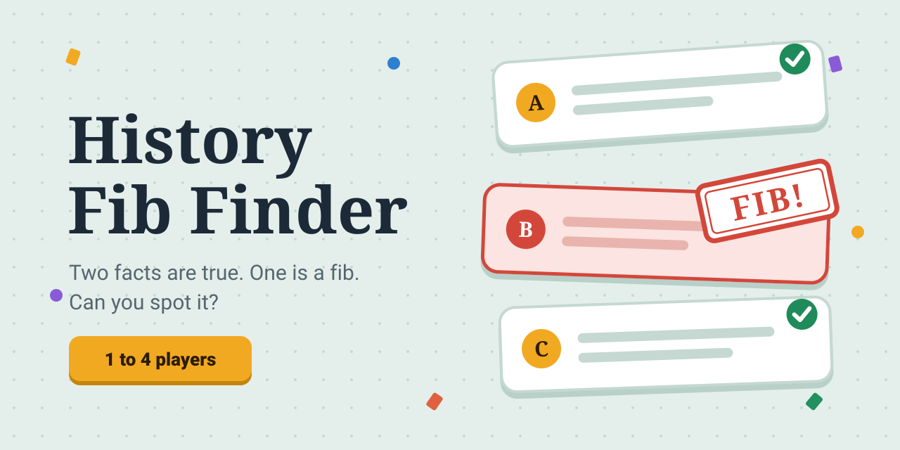

<p align="center">
  
</p>

<h1 align="center">History Fib Finder</h1>

<p align="center">
  <b>Two weird history facts are true. One is a fib. Can you spot it?</b><br>
  A pass-and-play party game for 1 to 4 players on one phone, tablet or laptop.
</p>

<p align="center">
  <a href="https://YOUR-USERNAME.github.io/history-fib-finder/"><b>▶&nbsp;&nbsp;Play now</b></a>
</p>

---

## 🎲 How to play

1. **Pick how many players** (1 to 4) and tap **Start**.
2. **Read the three facts.** Two really happened. One is made up.
3. **Tap the fib.** With more than one player, pass the screen along. A "no peeking" screen comes up between turns.
4. **See the truth.** A big red **FIB!** stamp lands on the fake, and a short note gives the real story.
5. **Score a point** for every fib you spot. After **5 rounds**, the most points wins! 🏆

A game takes about **5 to 10 minutes**. Each game draws 5 rounds at random from a bank of 12, so "Play again" gives you new facts.

## 🏛️ A taste of the facts

| True or fib? | |
|---|---|
| 🍅 Ketchup was once sold as medicine. | ✅ True |
| 🫧 Bubble wrap was first made to be wallpaper. | ✅ True |
| ⛑️ Vikings wore helmets with horns into battle. | 🔴 **Fib!** No horned Viking battle helmet has ever been found. |

## ✨ What makes it nice

- **Phone first.** Big buttons, all taps and no dragging. It fits any screen.
- **Kind to everyone.** A right answer gets confetti. A wrong one gets a gentle "so close!"
- **Family-friendly** facts in simple words that young players can read.
- **Light and dark mode** follow your device.
- **Private by design.** No sign-in, no names, no tracking. Nothing is saved or sent anywhere.
- **One file.** Plain HTML, CSS and JavaScript in [`index.html`](index.html), with nothing to install.

## 🛠️ Run it yourself

Download `index.html` and open it in any web browser. That's all it needs.

To add your own facts, open `index.html` and find the `BANK` list near the bottom. Each round has two true facts, one fib, and a one-line truth:

```js
{t:[["🍅","Ketchup was once sold as medicine."],
    ["🫧","Bubble wrap was first made to be wallpaper."]],
 f:["🍭","The first popsicle was invented by a king in the year 1600."],
 why:"An 11-year-old boy invented the popsicle by accident in 1905."}
```

---

<p align="center"><sub>Made for game night. Have fun, and keep an eye out for fibs! 🔍</sub></p>
